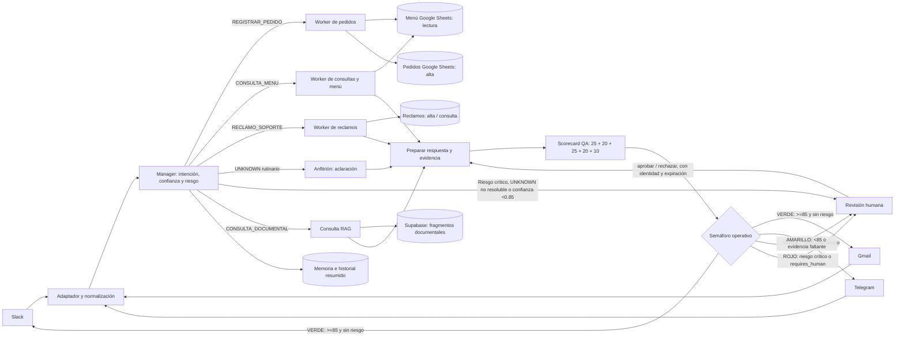

# Diseño arquitectónico de un sistema agéntico vertical

**Pre-entrega de diseño | Checkpoint 7**  
**Vertical:** Operaciones y experiencia del cliente para restaurante omnicanal  
**Proyecto:** GustoBot  
**Estado:** diseño editable alineado con los exports Checkpoint 7 y sus guardrails actuales.  
**Alcance de esta versión:** revisión del documento Markdown; el PDF queda expresamente fuera de esta etapa. La existencia de un nodo o una regla en un export no prueba que se haya ejecutado con credenciales reales.

## Resumen ejecutivo

GustoBot ya dispone de un flujo central multicanal, workers para pedidos, consultas, reclamos y bienvenida, memoria conversacional, Google Sheets, HubSpot, RAG con Supabase y entrada de voz por Telegram. La oportunidad de diseño no es crear otro agente, sino acotar mejor las funciones y permisos de esos especialistas, verificar las respuestas contra evidencia vigente y poner decisiones sensibles detrás de una aprobación humana.

Se propone priorizar la atención rutinaria de menú, pedidos y reclamos iniciales. La automatización podrá consultar y registrar datos de bajo riesgo; no podrá resolver por cuenta propia un reembolso, un incidente sanitario ni una interpretación legal. El tiempo de respuesta manual fue estimado por el usuario en 5 a 10 minutos por caso, pero aún no está medido; las metas de ahorro son objetivos de piloto, no resultados demostrados.

> **Semáforo de autonomía — resumen ejecutivo:** 🟢 lectura de fuentes y registro técnico mínimo; 🟡 respuestas rutinarias o escritura de pedido solo con evidencia, datos completos y confirmación; 🔴 salud/seguridad, dinero, temas legales y cambios/cierre de reclamos: detener automatización y pasar a una persona. Confianza menor a **0,85** también requiere revisión. La tabla completa y los disparadores están en la Página 3.

> **Criterio de evidencia:** lo que se identifica como “actual” se observó en los JSON, planillas o manuales disponibles. Permisos, responsables, objetivos y salvaguardas que no existen hoy se presentan como diseño recomendado, no como capacidades ya implementadas.

## Página 1 — Proceso, vertical y priorización

### Industria y problema operativo

**Industria:** servicios gastronómicos, atención omnicanal de restaurante. La operación recibe solicitudes por Slack, Gmail y Telegram, incluidas notas de voz en Telegram. El proceso requiere interpretar el pedido, consultar el menú o una política, comprobar datos del cliente, registrar la orden o el reclamo y responder por el canal correcto.

La fragmentación entre canales y planillas puede producir relecturas, datos incompletos, registros duplicados y respuestas que no reflejen el catálogo vigente. Los casos con alérgenos, reembolsos, posibles intoxicaciones, objetos extraños o amenazas legales tienen un costo potencial mayor y no deben resolverse con una respuesta automática no revisada.

### Framework de priorización del asesor

Escala propuesta: 1 = bajo, 5 = muy alto. Puntajes preliminares sujetos a validación con responsables de la operación.

| Vector | Puntaje | Evaluación crítica |
|---|---:|---|
| Impacto esperado | 5/5 | Pedidos, preguntas repetidas y recepción de reclamos son tareas frecuentes y estructurables. El potencial de ahorro y consistencia es alto, pero no se midió aún en minutos ni en costo. |
| Viabilidad técnica no-code | 4/5 | Ya existen workflows n8n, workers, Sheets, HubSpot, Supabase y conectores de Slack/Gmail/Telegram. No se asigna 5 porque deben probarse permisos, deduplicación, consistencia de las planillas y rutas de excepción. |
| Adopción probable | 4/5 | Se conservan canales y herramientas conocidas; la adopción depende de definir responsables de aprobación, capacitar al personal y demostrar calidad con un piloto. |
| **Prioridad ponderada** | **4,5/5** | Fórmula de planificación: impacto × 0,50 + viabilidad × 0,30 + adopción × 0,20. Es una priorización inicial, no un ROI medido. |

### Baseline manual (punto de partida)

**Proceso manual informado por el usuario:** el dueño es la única persona que atiende pedidos, consultas y reclamos y también se encarga de resolverlos. Revisa las solicitudes, consulta el menú cuando hace falta y responde. La secuencia detallada de registro en planillas y documentos sigue siendo una hipótesis por validar.

**Tiempo actual estimado:** de 5 a 10 minutos para responder cada caso, según el usuario, dependiendo de si se trata de una consulta, un pedido que requiere revisar el menú o un reclamo. Es una estimación declarada, no una medición de campo. El archivo `Logs_Ejecucion_GustoBot.xlsx` tiene 23 filas de ejecuciones históricas —17 con estado `success` y 6 `error`— pero no registra duración por caso ni representa por sí solo un baseline manual o de producción.

**Medición antes del piloto:** registrar durante 10 jornadas hábiles y, como mínimo, 30 casos por categoría (extender el período si no se alcanza la muestra). Medir mediana y P90 de primera respuesta y minutos de trabajo activo por caso, separados por categoría y canal; contar recontactos, errores/duplicados de registro y derivaciones. Comparar después con el mismo método.

## Página 2 — Arquitectura multi-agente y permisos

### Diagrama de coreografía propuesta



La arquitectura reutiliza el Manager-Worker y la división de adaptadores del Checkpoint 7. El RAG de consulta permanece separado de la ingesta documental de Drive. En el workflow exportado, el scorecard y el Switch de tres colores ya están conectados; las salidas amarilla y roja se detienen en HITL. Si una ejecución ya aprobada no supera QA al reintentar, queda asignada a una persona y no vuelve a solicitar la misma aprobación. La aprobación interactiva y los límites de permisos descritos abajo deben verificarse en n8n antes de producción.

### Roles y contratos de salida

| Agente | Misión y System Prompt constitutivo (diseño) | Herramientas / salida estructurada |
|---|---|---|
| **Manager / Router** | “Clasificá el mensaje en una intención permitida; evaluá riesgo y confianza con el contexto mínimo. No respondas al cliente ni registres acciones. Si faltan datos o hay riesgo crítico, marcá `requires_human=true`.” | Historial resumido y metadatos de canal. Entrega `intent`, `confidence`, `risk`, `requires_human`, `worker`, `missing_fields`. El router actual ya utiliza las intenciones `REGISTRAR_PEDIDO`, `CONSULTA_MENU`, `CONSULTA_DOCUMENTAL`, `RECLAMO_SOPORTE`, `UNKNOWN` y niveles LOW/MEDIUM/HIGH. |
| **Anfitrión** | “Recibí con cordialidad; identificá la necesidad y pedí solo el dato mínimo que falta. No inventes disponibilidad ni aceptes compromisos.” | Entrada de canal y contexto mínimo. Entrega `intent`, `next_question`, `customer_reply`; sin escritura en pedidos ni reclamos. |
| **Especialista de menú/consultas** | “Contestá sobre menú, ingredientes, precios y disponibilidad solo desde el catálogo vigente. No registres pedidos ni modifiques catálogo. Ante alergia severa, no garantices inocuidad y escalá.” | Google Sheets `Menu` lectura; consulta de estado solo por identificador mínimo. Entrega `answer`, `evidence[]`, `source_version`, `confidence`, `requires_human`. |
| **Especialista de pedidos** | “Validá producto, cantidad, datos requeridos y aceptación explícita del cliente. No cobres, cambies precios, canceles órdenes ni prometas tiempos no aprobados.” | Catálogo lectura y `Pedidos` append, solo después de confirmación. Entrega `order_draft`, `missing_fields[]`, `customer_confirmed`, `write_requested`. |
| **Especialista de reclamos** | “Escuchá y registrá el relato de manera fiel. Clasificá severidad según la matriz aprobada. No declares responsabilidad ni autorices reembolsos, cupones o cierre del caso.” | `Reclamos` append y lectura acotada del caso; no modificar estado sin autorización humana. Entrega `case_id`, `severity`, `critical_signal`, `evidence[]`, `requires_human`. |
| **Especialista documental (RAG)** | “Respondé solo con fragmentos recuperados y vigentes. Citá la fuente. Si no hay evidencia suficiente o hay contradicción, indicá que no se puede confirmar y escalá.” | Supabase lectura/top-K; sin acceso a Drive desde conversación. Entrega `answer`, `source_ids[]`, `evidence_quotes[]`, `confidence`. |
| **Preparador de voz** | “Resumí fielmente la respuesta aprobada para audio; no agregues hechos ni cambies el estado de pedido/caso. Respetá el límite de caracteres validado.” | Texto aprobado y canal; no consulta fuentes ni escribe datos. Entrega `voice_text`, `source_response_id`, `validation_status`. |

### Contratos JSON orientativos

```json
{
  "session_id": "id-no-secreto",
  "intent": "RECLAMO_SOPORTE",
  "confidence": 0.91,
  "risk": "HIGH",
  "requires_human": true,
  "worker": "Worker_Atencion_Reclamos",
  "missing_fields": [],
  "channel": "telegram"
}
```

```json
{
  "case_id": "id-de-caso",
  "answer": "Respuesta breve basada en evidencia.",
  "evidence": [
    {"source_id": "policy-id", "quote": "Fragmento relevante", "version": "vigente"}
  ],
  "write_requested": false,
  "requires_human": true
}
```

Estos contratos son un diseño objetivo: los workers existentes reciben principalmente `original_input` y `tipo_entrada`; ampliar campos a JSON explícito requiere una tarea posterior y pruebas de compatibilidad.

### Mapa de permisos de mínimo privilegio

| Rol / sistema | Acceso recomendado | Justificación |
|---|---|---|
| Manager / memoria en Google Sheets | Lectura por `Session_ID`; escritura de resumen y estado acotados | Recupera continuidad sin dar acceso a todas las interacciones ni a datos no relacionados. |
| Menú en Google Sheets | Lectura únicamente | Necesita consultar catálogo; no necesita publicar cambios de menú o precios. |
| Pedidos en Google Sheets | Lectura limitada de catálogo/estado; append de orden confirmada | Permite registrar un pedido nuevo; no borrar ni sobrescribir órdenes o precios. |
| Reclamos en Google Sheets | Append para reclamos rutinarios y lectura para consulta; ninguna escritura de estado por el agente | El worker conserva las tres herramientas del export descargado. Las herramientas históricas de estado se describen y configuran como lectura; no deben usarse para cambiar ni cerrar casos. La actualización queda reservada a una persona. |
| Logs en Google Sheets | Append de evento y decisión; evitar transcripción completa | Trazabilidad de operación con minimización de información del cliente. |
| HubSpot | Búsqueda y alta/actualización mínima de contacto, solo en el adaptador Gmail | Mantener el CRM sincronizado sin ampliar el acceso de todos los workers. |
| Supabase | Lectura de `document_chunks` para RAG; sin borrar/escribir desde agente conversacional | Recuperación de fuente aprobada sin modificar evidencia. |
| Google Drive | Lectura en el workflow separado de ingesta; escritura en Supabase solo en el proceso de indexación aprobado | Aislar publicación documental de la conversación con clientes. |
| Slack | Envío de alerta y aprobación interactiva al grupo/usuario autorizado | Coordinar HITL; no exponer datos del caso a canales públicos. |
| Gmail | Recepción y creación de borrador; envío solo para acciones elegibles y aprobadas | Separar recepción, preparación y autorización del mensaje saliente. |
| Telegram | Respuesta al chat de origen; solicitud de aprobación solo donde el flujo actual la soporte | No permitir acciones sobre otros chats o clientes. |

### Context Engineering: contexto que entra y que se excluye

| Worker | Contexto que recibe | Queda afuera deliberadamente |
|---|---|---|
| Manager | Mensaje actual (límite 4.000 caracteres), canal, `Session_ID`, estado del caso, resumen reciente (hasta 4.000) y datos clave necesarios (hasta 1.500). | Historial sin límite, credenciales, pago, binario de audio una vez transcrito, conversaciones de otras sesiones. |
| Menú | Pregunta actual, parámetros del producto y fila vigente del menú. | Historial completo, datos CRM y detalles de pedidos ajenos. |
| Pedidos | Mensaje actual, productos/cantidades normalizados, disponibilidad/precio vigente, campos de contacto indispensables, canal y confirmación explícita. | Datos de pago, pedidos de otros clientes, reclamos no relacionados. |
| Reclamos | Mensaje actual, `case_id`/pedido si existe, relato del cliente, evidencia adjunta solo si fue autorizada y clasificación de severidad. | Historial completo, credenciales, inferencias sobre responsabilidad o elegibilidad de reembolso. |
| RAG | Consulta normalizada y máximo cuatro fragmentos recuperados con metadatos/fuente; política y versión vigente. | Documentos no recuperados, fuentes contradictorias no señaladas, binarios ya descartados. |
| Memoria | Resumen verificable, estado del caso, restricciones y próximos pasos; consolidar después de más de cinco mensajes según lógica actual. | Contraseñas, tokens, datos de pago, transcripciones extensas y detalles sensibles que no sean necesarios. |
| Voz | Solo respuesta ya aprobada y canal/formato de salida. | No volver a enviar audio del cliente a otros agentes ni inventar contenido para completar datos faltantes. |

## Página 3 — Valor, KPI y fronteras de autonomía

### Propuesta de valor

GustoBot puede reducir el esfuerzo de atender consultas repetidas, mantener respuestas de menú más consistentes y dejar pedidos y reclamos mejor documentados. El equipo conserva el control de decisiones sensibles y recibe casos críticos con un resumen y la evidencia disponible, en vez de tener que reconstruir la conversación en varios canales.

### Criterios de éxito del piloto (objetivos antes de implementación)

| KPI | Definición | Objetivo inicial |
|---|---|---:|
| Tiempo de primera respuesta | Mediana por categoría/canal versus el baseline medido | Reducción ≥30%, sin bajar exactitud o satisfacción. |
| Resolución autónoma válida | Casos elegibles resueltos sin intervención y aprobados en auditoría / total elegible | ≥60% en menú y consultas rutinarias tras el piloto. |
| Exactitud con fuente | Respuestas alineadas con una fuente vigente / muestra revisada | ≥95%; cero decisiones rojas autónomas. |
| Integridad de pedido/reclamo | Registros con campos obligatorios correctos / muestra | ≥98%; medir además duplicados. |
| Escalado crítico oportuno | Casos críticos notificados dentro de 1 minuto / total críticos | ≥95%; probar canal caído y timeout. |

Las metas son criterios de aceptación sugeridos, no resultados actuales. Informar denominadores y tamaño de muestra en cada comparación.

### Semáforo operativo y umbral de confianza

| Acción concreta | Semáforo | Qué hace el sistema / frontera exacta |
|---|---|---|
| Clasificar intención y consultar menú o documento vigente para uso interno. | 🟢 Verde | Puede hacerlo sin aprobación si la fuente existe, la intención es rutinaria y no hay señal crítica. La lectura no modifica la fuente. |
| Registrar un log técnico mínimo de ejecución. | 🟢 Verde | Puede agregar el evento mínimo para auditoría; no guardar transcripciones completas ni datos sensibles innecesarios. |
| Enviar una respuesta rutinaria de menú o política con respaldo documental. | 🟡 Amarillo | Solo si confianza ≥0,85, evidencia vigente y datos suficientes. Si falta evidencia, hay conflicto o confianza <0,85, no responde sobre el fondo: deriva a revisión humana. |
| Registrar un pedido en Google Sheets. | 🟡 Amarillo | Solo tras verificar productos en el menú, recibir el prefijo exacto `CONFIRMO PEDIDO:` junto con el pedido completo, y validar nombre, teléfono o correo y detalle. El nodo de escritura está detrás de una condición determinística; cualquier validación fallida impide el append. |
| Registrar un reclamo operativo rutinario. | 🟡 Amarillo | Solo con relato fiel y datos mínimos completos, sin señal de salud/seguridad, dinero, fraude o riesgo legal. La respuesta de confirmación se da únicamente si la escritura terminó bien. |
| Crear/enviar correo al cliente sobre una excepción, o aprobar una respuesta no rutinaria. | 🟡 Amarillo | Mantener como borrador o en espera hasta revisión. Gmail no debe enviar una resolución sensible automáticamente. |
| Reembolso, cobro, cupón/compensación, alterar precio, resolver/cerrar/cancelar reclamo o pedido, asesorar sobre derechos, afirmar seguridad ante alergia o intoxicación. | 🔴 Rojo | Congelar la acción. No ejecutar escritura ni responder sobre el fondo; revisión humana obligatoria. El agente no promete resultado ni ejecuta transacciones. |

**Umbral propuesto: 0,85.** Se elige alto porque un mensaje externo incorrecto o un registro equivocado tiene un costo superior a la demora breve de revisión. La confianza del modelo no sustituye evidencia, confirmación ni clasificación de riesgo.

**Correspondencia con los exports actuales:** el flujo principal aplica el umbral de confianza 0,85 antes de delegar y, después de cada worker, ejecuta el nodo nativo `Semáforo + Scorecard QA` y el Switch `VERDE / AMARILLO / ROJO`. Solo VERDE (puntaje ≥85, sin riesgo crítico ni `requires_human`) continúa al canal de salida; AMARILLO y ROJO pasan a HITL. La falta de evidencia estructurada no se sustituye por texto libre. Los pedidos tienen además una compuerta de confirmación explícita y evidencia de menú antes de escribir. Esto describe la configuración exportada, no una prueba de ejecución en producción. La aprobación interactiva de Slack y la recepción de un acuse no autorizan reembolsos ni escrituras rojas.

### Escalado forzado a personas

| Disparador | Responsable propuesto | Canal y acción |
|---|---|---|
| Riesgo de alergia severa, anafilaxia, intoxicación o cuerpo extraño | Dueño; asesoramiento especializado cuando corresponda | Alerta inmediata por Slack con resumen mínimo. El flujo se detiene; el cliente recibe un aviso de seguimiento humano. |
| Solicitud de reembolso, cupón o dinero | Dueño | Slack interactivo `Aprobar / Rechazar`; registrar aprobador, hora y decisión. No ejecutar pago por parte del agente. |
| Amenaza legal, denuncia o solicitud de interpretación jurídica | Dueño; asesoramiento legal cuando corresponda | Slack al responsable. No interpretar derechos ni emitir admisión de responsabilidad. |
| Cancelación/insatisfacción reiterada, `UNKNOWN`, baja confianza (<0,85), evidencia ausente o contradictoria | Dueño | Slack interactivo para decisión. En Gmail, dejar borrador; en Telegram, no enviar contenido sustantivo hasta decisión humana. |

**Controles de la aprobación:** `case_id` único, identidad autorizada, acción exacta aprobada, expiración e idempotencia. Rechazo, timeout, usuario no autorizado o fallo del canal significan “no ejecutar” y mantener el caso en revisión. El export central contiene un paso de aprobación Slack `sendAndWait`; antes de producción se debe verificar en n8n que cada disparador llegue a esa ruta, que los botones/acciones visibles sean inequívocos y que solo el responsable autorizado pueda decidir. Los acuses de Gmail/Telegram no reemplazan la aprobación humana.

## Página 4 — Scorecard y versión de portafolio

### Playbook / rúbrica de evaluación analítica

Cada worker devuelve evidencia estructurada como objetos `source` + `quote`; en RAG, la cita se deriva de los fragmentos recuperados. El scorecard implementado es determinístico (nodo Set), no un juez LLM independiente: valida la presencia y el formato de la evidencia y los controles operativos antes del Switch. En workers con herramientas, la cita la declara el agente a partir de la fuente conectada; esta compuerta estructural no demuestra por sí sola la veracidad semántica de cada cita. Puntuación de 0 a 100; una regla roja prevalece siempre sobre el puntaje.

| Criterio | Peso | Puntaje completo | Regla de falla |
|---|---:|---|---|
| Respuesta y alcance del worker | 25 | Estado permitido (`success` o `awaiting_confirmation`), worker y respuesta presentes, sin `requires_human`. | Salida incompleta, error o revisión requerida: no enviar. |
| Campos y consentimiento | 20 | Para PEDIDOS: espera confirmación o confirma un registro hecho tras la validación; otros workers reciben los puntos completos. | Una escritura de pedido no validada no pasa el control determinístico del worker. |
| Evidencia estructurada | 25 | Existe al menos una cita no vacía con `source` y `quote`; ANFITRION está exento por no emitir hechos operativos. | Evidencia ausente/malformada: 0 puntos y derivación a HITL. |
| Riesgo y política | 20 | `risk` es LOW/MEDIUM, no hay `critical_signal` y no se requiere supervisión. | HIGH, señal crítica o `requires_human`: ROJO y HITL, sin excepción por score. |
| Respuesta y trazabilidad | 10 | `status`, `worker` y `respuesta` están presentes. | Falta un campo de salida obligatorio: puntaje parcial y revisión. |

**Interpretación implementada:** 85–100 puede salir únicamente en VERDE y si no requiere supervisión; menos de 85 queda AMARILLO y se deriva a HITL. Una señal crítica o `requires_human` produce ROJO, sin importar el puntaje. Un score alto nunca convierte una acción roja en autónoma.

**Forma de salida QA observada en el workflow:**

```json
{
  "score_scope": 25,
  "score_consent": 20,
  "score_evidence": 25,
  "score_risk": 20,
  "score_traceability": 10,
  "score_total": 100,
  "semaforo": "VERDE",
  "evidence": [{"source": "Menu_GustoBot", "quote": "fragmento respaldatorio"}],
  "requires_human": false
}
```

### Portafolio profesional (versión anonimizada)

**Diseño de atención omnicanal para restaurante:** especialización de un sistema Manager-Worker preexistente para consultas de menú, registro de pedidos y recepción de reclamos. El diseño combina clasificación por riesgo, contexto mínimo por rol, búsqueda documental con evidencia, permisos relacionales y escalado humano de casos económicos, legales y sanitarios. El resultado esperado es una atención más consistente y trazable, con autonomía limitada por controles verificables. Caso académico anonimizado; se excluyen datos personales, credenciales y contenido de clientes.

## Fuentes, supuestos y riesgos pendientes

1. `README.md` y exports de Checkpoint 7: workflow central, adaptadores, memoria, RAG, workers, HITL, canales y herramientas actuales.
2. `CLASE - Manager Multiagente + Memoria Persistente + Worker Customer.json` y `Clase - Worker Customer.json`: patrones de separación Router/Worker, contexto de memoria y escalado de Customer Success; se usan como referencia, sin modificar esos ejemplos.
3. `Menu_GustoBot.xlsx`, `Pedidos_GustoBot.xlsx`, `Reclamos_GustoBot.xlsx` y `Logs_Ejecucion_GustoBot.xlsx`: estructuras y señales históricas. Las filas de muestra contienen información identificable; este documento no reproduce datos de clientes.
4. `Manual de Politicas y Evaluacion v5.pdf`: fuente de políticas de menú, alérgenos, reembolsos y severidad. **Riesgo de jurisdicción:** el manual cita el artículo 34 de la Ley 24.240 (Argentina), mientras los activos del proyecto incluyen precios en CLP y respuesta chilena. No automatizar una decisión legal o financiera hasta confirmar jurisdicción, versión autorizada y aprobación del responsable.
5. El tiempo manual de 5 a 10 minutos es una estimación del usuario, aún no medida; las metas de exactitud y adopción son objetivos para el piloto, no métricas ya observadas. Las escrituras actuales de pedidos y reclamos requieren validar confirmación del cliente, deduplicación e idempotencia antes de habilitar autonomía.
6. **Alcance no-code:** el diseño se modela con nodos visuales n8n y conectores nativos, pero los exports actuales también contienen nodos Code para normalización y validación. Por ello, no se afirma que la implementación existente sea estrictamente 100% no-code; si el comité exige esa condición en ejecución, esos pasos deben reemplazarse por nodos nativos equivalentes y volver a probarse.
7. **Aprobación y escrituras:** el export actualizado impide volver a llamar al worker tras la aprobación si el caso pendiente tiene riesgo HIGH o señal crítica, y comprueba `requires_human` antes de enviar una respuesta aprobada. El worker de reclamos conserva una herramienta de alta invocable por el agente en casos elegibles. Verificar los controles en n8n y los permisos efectivos: políticas y prompts no equivalen a permisos técnicos. Si un subworkflow devuelve un `worker` distinto del esperado, el flujo marca `WORKER_CONTRACT_MISMATCH` y deriva a una persona; esa detección ocurre después de la llamada y no deshace eventuales escrituras anteriores.
8. **Evidencia de menú:** las capturas aportadas muestran avisos en Slack al aprobar y rechazar, pero no prueban todavía una respuesta factual exitosa con filas reales y semáforo verde. La verificación de evidencia estructurada no garantiza que cada afirmación esté sustentada semánticamente.
