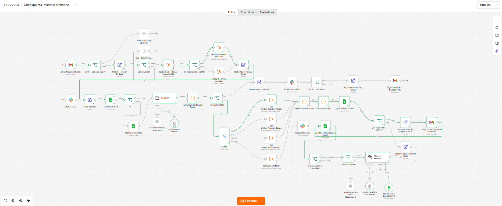
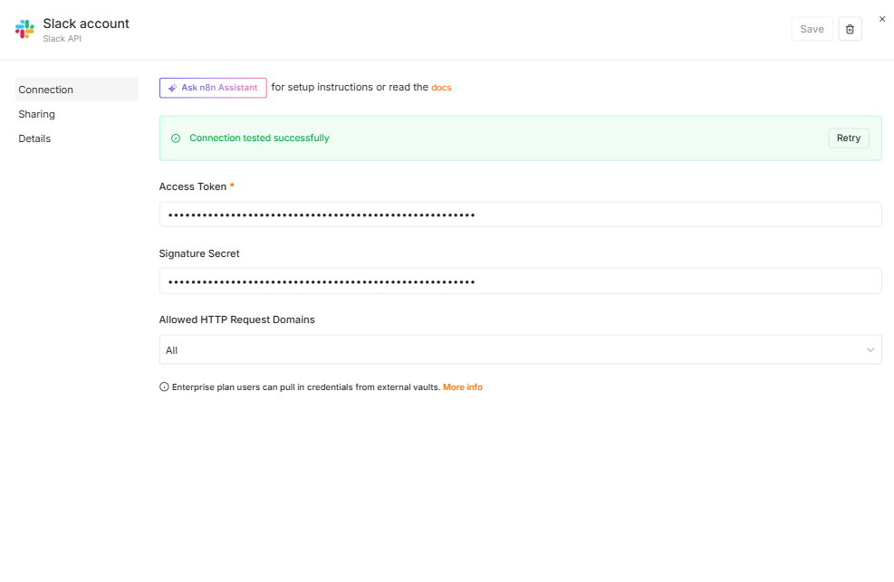
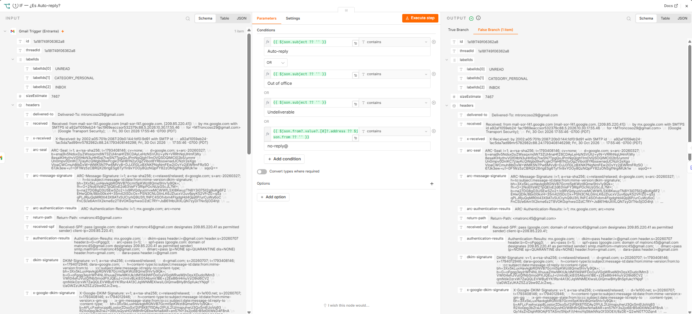
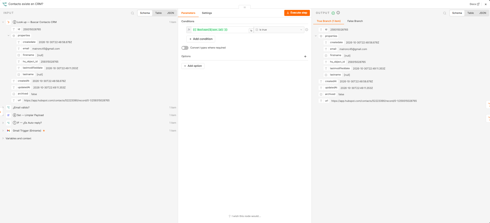
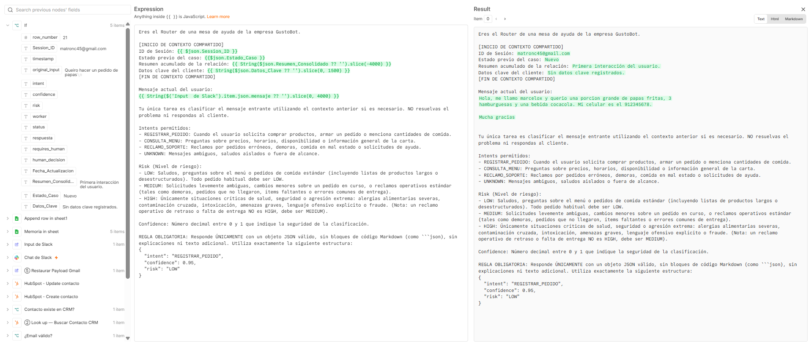
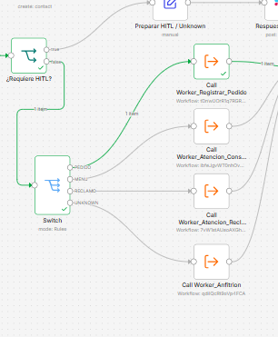
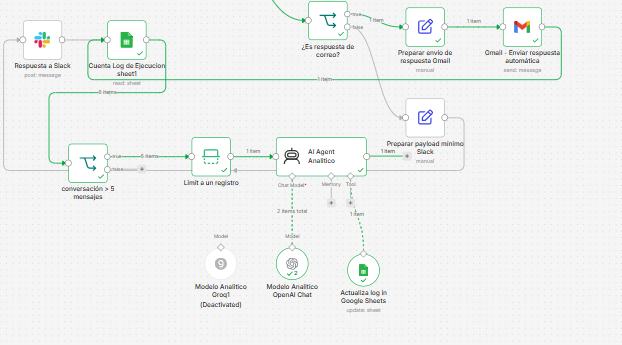

# GustoBot | Flujo omnicanal de pedidos y atención (Checkpoint 7)

---

## Descripción del proyecto

**GustoBot** es un asistente virtual para gestionar pedidos, consultas y reclamos de un restaurante. El **Checkpoint 7** continúa la solución del Checkpoint 6: conserva la arquitectura multi-agente Manager-Worker, la atención por Slack, Gmail y Telegram, HubSpot, revisión humana (HITL) y RAG documental con Supabase. La solución separa el procesamiento central de los adaptadores de canal: Slack, Gmail y Telegram normalizan sus entradas y llaman al workflow central; la ingesta documental de Drive queda en otro workflow.

## Archivos y recursos

* **`Checkpoint7_Final_VoiceAI_Telegram.json`**: workflow central de conversación. Recibe campos normalizados explícitos (`mensaje`, `original_input`, `usuario_id`, `canal`, `tipo_entrada` y metadatos de canal) por `Execute Workflow`; conserva el enrutamiento, workers, RAG de consulta y HITL.
* **`Checkpoint7_Slack_Channel_Module.json`**: adaptador Slack para entradas de texto/audio, transcripción y contingencias.
* **`Checkpoint7_Gmail_Channel_Module.json`**: adaptador Gmail para filtrar correos, validar remitentes y preparar el payload de conversación.
* **`Checkpoint7_Telegram_Voice_Module.json`**: adaptador de voz de Telegram. Descarga y transcribe el audio, valida la transcripción y llama al workflow central sin transferir el binario.
* **`Checkpoint7_RAG_Ingestion_Module.json`**: workflow independiente para triggers de Drive, extracción, deduplicación, aprobación de reemplazos e indexación en Supabase.
* **`PreEntrega_Checkpoint7_Diseno_Arquitectonico_GustoBot.pdf`**: informe de diseño agéntico vertical, gobernanza, scorecard y escalado HITL.
* **`Diseno_Arquitectonico_Checkpoint7_GustoBot.md`**: fuente editable del diseño arquitectónico y diagramas; actualizar esta versión antes de preparar el PDF.
* **`Supabase_document_chunks.sql`**: esquema de la tabla vectorial `document_chunks` y función `match_document_chunks`.
* **`Worker_Registrar_Pedido.json`**: worker para registrar pedidos.
* **`Worker_Atencion_Consultas.json`**: worker para responder consultas.
* **`Worker_Atencion_Reclamos.json`**: worker para atender reclamos.
* **`Worker_Anfitrion.json`**: worker de bienvenida y solicitudes generales.
* **Planillas de datos y auditoría**: `Menu_GustoBot.xlsx`, `Pedidos_GustoBot.xlsx`, `Reclamos_GustoBot.xlsx` y `Logs_Ejecucion_GustoBot.xlsx`.
* **[Pantallazos de evidencia del Checkpoint 4](https://docs.google.com/document/d/1o2TdufEyv6BqBbX8gGqfmB_-vun86KBp8qrNTTiD2_0/edit?usp=drive_link)**: capturas de la entrega, disponibles en el documento compartido.
* [Planilla de logs en Google Sheets](https://docs.google.com/spreadsheets/d/1NmEYqoD3hRMmt2Ni0o4Um-sMYp7XUr-zP_bda_Aw64Y/edit?usp=drivesdk).
Flujo completo: 

## Arquitectura del Checkpoint 7

El Checkpoint 7 mantiene las ramas de atención descritas abajo, la recuperación documental e ingesta en Supabase, y suma el circuito de voz.

### 1. Ingreso por Slack y Gmail

* **Slack** recibe mensajes del canal configurado y los prepara en un payload mínimo para el procesamiento.

* **Gmail** consulta cada minuto los correos no leídos. Antes de procesarlos, el flujo descarta respuestas automáticas y mensajes de remitentes `no-reply`; luego normaliza remitente, asunto y cuerpo.

### 2. CRM y clasificacion

Para solicitudes recibidas por correo, el flujo busca el contacto en **HubSpot** y lo crea o actualiza según corresponda. El router IA clasifica las solicitudes en una taxonomía cerrada:

* `REGISTRAR_PEDIDO`
* `CONSULTA_MENU`
* `CONSULTA_DOCUMENTAL`
* `RECLAMO_SOPORTE`
* `UNKNOWN`

La clasificación se normaliza antes de continuar; una salida no reconocida se trata como `UNKNOWN`. El flujo incluye modelos de Groq y OpenAI para las etapas de IA.

### 3. Derivación a workers y revisión humana

El Manager deriva las solicitudes clasificadas a los sub-workflows correspondientes:

* `REGISTRAR_PEDIDO` -> `Worker_Registrar_Pedido`
* `CONSULTA_MENU` -> `Worker_Atencion_Consultas`
* `RECLAMO_SOPORTE` -> `Worker_Atencion_Reclamos`
* `UNKNOWN` y casos que requieren revisión -> camino de atención humana

Las llamadas a los workers esperan su finalización para preparar la respuesta. En Slack, los casos de revisión humana se comunican por el canal. Para Gmail, el flujo prepara un borrador para revisión; los casos que no requieren intervención pueden recibir una respuesta automática, previa validación del correo.

### 4. Memoria y auditoria

Google Sheets almacena los registros de ejecución y la memoria conversacional. El workflow recupera el historial y evalúa si supera los **5 mensajes** para activar el procesamiento analítico y actualizar el registro de memoria.

### 5. RAG e ingesta documental

Las consultas institucionales se derivan a una búsqueda RAG conectada a la tabla `document_chunks` de Supabase. La recuperación devuelve hasta cuatro fragmentos (Top-K = 4) ordenados por similitud, sin un umbral fijo que pueda excluir consultas válidas. Si no se recupera contexto, el flujo responde directamente que no hay información disponible; las respuestas generadas se restringen a los fragmentos. Las consultas sobre arrepentimiento se amplían con términos legales relacionados para distinguirlas de reembolsos por fallas. Los documentos nuevos o modificados en la carpeta de Google Drive se descargan, se procesan como PDF, se fragmentan en bloques de 1000 caracteres con solapamiento de 200 y se indexan con embeddings de OpenAI. Antes de indexar, la ingesta busca la combinación exacta de `drive_file_id` y `content_hash` en los metadatos para omitir archivos ya cargados; los registros históricos sin esas claves no pueden detectarse mediante esta regla. La limpieza de fragmentos anteriores se ejecuta después de insertar la nueva versión. Las respuestas automáticas se envían por el canal de origen: Slack responde al canal del mensaje y Gmail al remitente del correo.

Ejecuta `Supabase_document_chunks.sql` en Supabase antes de usar esta rama. Configura las credenciales de Google Drive, Supabase y OpenAI en n8n.

### 6. Voice AI final por Telegram

Para la entrega se utiliza un bot oficial de Telegram creado con BotFather. El workflow importable es [`Checkpoint7_Final_VoiceAI_Telegram.json`](./Checkpoint7_Final_VoiceAI_Telegram.json). Parte de la evolución del Módulo 5 y Checkpoint 6, y conserva RAG, workers y las ramas existentes. La transcripción de Telegram entra en `Entrada multicanal`, atraviesa el enrutamiento central, RAG, workers y HITL, y solo la respuesta final vuelve a la rama TTS de Telegram: Telegram Trigger, IF de nota de voz, descarga binaria, Whisper, IF de contingencia, AI Agent central en modo Tools Agent, validación de 200 caracteres, ElevenLabs y Telegram Send Audio.

El nodo de Whisper recibe obligatoriamente el binario `data` y el idioma `es`. La rama falsa del IF posterior a Whisper cubre transcripciones vacías; la salida de error de Whisper, del agente, del validador y de ElevenLabs converge en un fallback de texto. El AI Agent está marcado como `toolsAgent` y tiene conectada la herramienta `Telegram Voice - Herramienta validar salida`. La respuesta se valida nuevamente antes de generar audio, por lo que el límite de 200 caracteres no depende solo del prompt.

**System Prompt exacto del AI Agent central:**

> Sos el agente central de enrutamiento de voz de GustoBot. Elegí la ruta de atención según la transcripción y el contexto. No respondas al cliente ni registres pedidos: la ruta seleccionada pasa por los controles de riesgo, la aprobación humana y el worker correspondiente. Los workers y la preparación posterior deben mantener las respuestas de voz en un máximo de 200 caracteres, sin enlaces, viñetas ni emojis.
>
> Usá exactamente una vez la herramienta Seleccionar ruta voz. Su entrada debe ser un string JSON con intent, confidence y risk. Intent permitido: REGISTRAR_PEDIDO, CONSULTA_MENU, CONSULTA_DOCUMENTAL, RECLAMO_SOPORTE o UNKNOWN. Confidence es un número entre 0 y 1. Para entradas de audio, toda respuesta final debe limitarse a 200 caracteres y no incluir enlaces, viñetas ni emojis.

ElevenLabs usa `eleven_multilingual_v2`, idioma `es`, Stability `0.65` y Clarity/Similarity `0.80`. Telegram envía el binario generado con la operación `Send Audio` y la propiedad `data`.

**Privacidad y descarte:** `saveDataSuccessExecution` y `saveDataErrorExecution` están en `none`, el progreso no se guarda y los nodos `Privacy - Descartar...` eliminan el objeto binario antes de continuar. No hay nodos de base de datos, Drive ni planilla en este workflow. El audio solo permanece durante la ejecución y se descarta al terminar; la retención del mensaje original en Telegram y la configuración de almacenamiento de la instancia deben verificarse por separado.

### Antecedente del checkpoint 6: Voice AI por Slack

El **Slack Trigger** del checkpoint histórico conserva la entrada de mensajes y también detecta archivos compartidos, descargándolos como binarios. Una condición IF distingue archivos de audio de mensajes de texto: los textos siguen por la ruta existente; los audios se mapean a `data` y se transcriben con **OpenAI Whisper** en idioma `es`. La entrega final no usa esta ruta: se dejó como antecedente para evitar confundir Slack con el canal solicitado.

Para audio, después de entrar por `Entrada multicanal` y recuperar el contexto, **AI Agent central - Enrutamiento de voz** selecciona una sola ruta mediante su herramienta **Seleccionar ruta voz**. La clasificación validada pasa por el control de riesgo y aprobación humana antes del Switch y los workers; el agente no ejecuta directamente los workers ni redacta la respuesta final. Las consultas documentales conservan su ruta RAG. Las decisiones HITL se envían al aprobador autorizado por Slack; Telegram y Gmail no se usan para pedir aprobación al cliente. En Slack no se publica un acuse en el canal antes de la decisión; el aprobador recibe el mensaje interactivo `sendAndWait`. Para Gmail el acuse queda como borrador y Telegram conserva su acuse neutral. La respuesta final de un mensaje Telegram/audio se redacta, valida, convierte con ElevenLabs y se envía por Telegram. Si el agente falla o no usa exactamente una vez la herramienta, se deriva a contingencia y no se ejecuta ningún worker.

Las respuestas de los workers y RAG reciben instrucciones condicionales para solicitudes de audio. La cadena **Redactar respuesta natural para voz** resume la respuesta en español de Chile, prioriza preguntas y confirmaciones pendientes y escribe cifras y unidades en palabras; por ejemplo, `CLP 1.500` pasa a «mil quinientos pesos chilenos». Si el primer resumen supera 200 caracteres, se solicita una sola vez otro más breve a partir de la respuesta original. Luego se valida que el texto no esté vacío, no supere 200 caracteres Unicode, no incluya cifras, enlaces, formato ni emojis, y conserve al menos una pregunta si el original la contiene. La validación no garantiza fidelidad semántica ni exactitud de cantidades: deben verificarse en pruebas reales. Si falla la redacción o la validación, se envía la respuesta original por escrito en el hilo, sin limitarla a 200 caracteres. **ElevenLabs** usa el modelo *Eleven Multilingual v2*, voz institucional y ajustes iniciales de Stability 0.65 y Clarity (similarity) 0.80. Slack publica el archivo de audio en el hilo original y su texto como comentario. Si falla la generación o carga de audio, se publica el texto de voz preparado.

**System Message para respuestas de voz:**

> Si el mensaje del usuario indica "Canal de respuesta: audio (Slack).", responde en español claro con un máximo de 200 caracteres. No uses enlaces, viñetas ni emojis. Redacta una respuesta breve y natural para escuchar. Para mensajes de texto, conserva las reglas de salida existentes.

**Evaluación de viabilidad:** la voz es viable de forma condicionada para consultas breves y frecuentes que se hacen con las manos ocupadas; reduce la fricción de entrada y limita la carga auditiva con respuestas cortas. No conviene para ambientes ruidosos, información sensible que no deba oírse en público ni respuestas extensas. Antes de escalar, comparar el costo de STT/TTS y la tasa de transcripción correcta con el tiempo de atención manual ahorrado. Las condiciones de contingencia evitan seguir con transcripciones vacías o errores de transcripción.

**Privacidad:** el workflow desactiva el guardado de ejecuciones exitosas, fallidas y manuales, así como el guardado del progreso, y elimina los binarios de los items que continúan por los nodos de limpieza. Esto afecta a todo el workflow y limita el diagnóstico en el historial. No garantiza la destrucción inmediata: los pasos de aprobación que esperan una respuesta pueden requerir persistir datos de la ejecución. Verifica los ajustes efectivos de la instancia y su almacenamiento binario; en n8n autohospedado, `N8N_DEFAULT_BINARY_DATA_MODE=default` utiliza memoria para los binarios, pero no elimina los datos que puedan persistirse en ejecuciones en espera. Revisa también la retención de Slack y de los proveedores de voz. Slack conserva los archivos según la configuración del espacio de trabajo. Se conserva el registro textual ya existente en Google Sheets. La eliminación segura de datos ya almacenados requiere un procedimiento de retención específico; estos ajustes no borran ejecuciones anteriores.

**Configuración de Slack:** el Slack App debe suscribirse al evento de archivos compartidos en el canal configurado y tener los scopes `files:read` y `files:write`, además de los permisos de mensajes existentes. La credencial de n8n debe poder leer y publicar archivos en ese canal. El módulo elimina el filtro de usuario del trigger y descarta eventos del bot antes del procesamiento; esto evita que el acuse o la respuesta publicada por el propio bot vuelva a iniciar el flujo. Si se agregan scopes, reinstala la app en el workspace y actualiza la credencial si corresponde. Un error 403 al descargar puede indicar permisos insuficientes o falta de acceso al archivo; se debe verificar con la configuración real de Slack.

## Importar el workflow

Importa primero `Checkpoint7_Final_VoiceAI_Telegram.json`; después importa los módulos `Checkpoint7_Slack_Channel_Module.json`, `Checkpoint7_Gmail_Channel_Module.json` y `Checkpoint7_Telegram_Voice_Module.json`. En cada módulo, confirma que `Call - Core Conversation Workflow` apunte al workflow central importado y que tenga mapeados los campos explícitos del contrato; no uses un campo único llamado `payload`. Si n8n asigna un ID diferente al importar, vuelve a seleccionar el workflow central en ese nodo. Importa también `Checkpoint7_RAG_Ingestion_Module.json` y los cuatro workflows de worker requeridos por el workflow central.

El workflow central fuerza HITL cuando la confianza es menor a 0,85, la intención es `UNKNOWN`, el riesgo es `HIGH` o el mensaje contiene señales de salud/seguridad, reembolso, reclamo legal o cierre/cambio de un caso. La falta de evidencia RAG también se deriva a revisión y no produce una respuesta factual automática. Antes del enrutamiento, `Memoria - Seleccionar último registro` reduce las filas históricas de Google Sheets a la más reciente para que una entrada genere una sola clasificación y no dispare en paralelo una respuesta y una aprobación. Las solicitudes HITL de Slack esperan la decisión del aprobador antes de continuar y no publican un acuse neutral previo en el canal; Gmail genera un borrador de acuse y Telegram conserva el suyo.

Después de cada respuesta de worker, `Semáforo + Scorecard QA` calcula los cinco componentes (25/20/25/20/10) y el Switch visible ramifica VERDE, AMARILLO y ROJO. Solo VERDE con puntaje de 85 o más sigue automáticamente al canal de salida. AMARILLO y ROJO pasan a HITL; tras una aprobación, el flujo vuelve a ejecutar el worker solo para casos LOW/MEDIUM sin señales críticas. Solo envía la respuesta factual si el riesgo es LOW/MEDIUM, no hay señal crítica, el worker no requiere intervención humana y la respuesta incluye evidencia válida con fuente y cita. La aprobación no anula la falta de evidencia: si el reintento tampoco la obtiene, el caso sigue asignado a una persona y Slack recibe un aviso de seguimiento, no una respuesta factual sin verificar. Los casos con riesgo HIGH o señal crítica permanecen en atención humana incluso después de la aprobación. Los workers de consultas y pedidos devuelven los pasos intermedios de las herramientas y construyen `evidence` desde las filas realmente observadas; el worker de pedidos agrega también la salida efectiva del nodo de registro. El worker de reclamos deriva evidencia de las salidas reales de sus herramientas, y solo confirma un registro si existe una salida observada de la herramienta de escritura. Ninguno considera válida una cita proporcionada únicamente por el modelo. El scorecard verifica estructura y controles operativos, no constituye una verificación semántica independiente de cada cita. La entrada HITL unifica los items de una misma ejecución para crear una sola solicitud y evitar avisos duplicados.

El worker de pedidos ahora pide que el cliente repita el detalle con `CONFIRMO PEDIDO:` y solo después de validar determinísticamente la confirmación y los datos mínimos escribe en Sheets. El worker de reclamos conserva el modelo OpenAI y las tres herramientas originales de Google Sheets. Las herramientas de consulta de estado son de solo lectura y no deben usarse para modificar o cerrar casos.

Configura las credenciales necesarias para Telegram, Slack, Gmail, HubSpot, Google Sheets, Google Drive, Supabase, OpenAI y ElevenLabs en los workflows que las usan. Verifica las conexiones y permisos de cada integración antes de activar los workflows. Activa por separado los tres adaptadores de canal y el workflow de ingesta RAG cuando sus credenciales y suscripciones estén verificadas.

En consultas vegetarianas o veganas, el worker de menú solo presenta productos como tales cuando una fila consultada contiene una etiqueta dietaria explícita. Si los resultados solo incluyen ingredientes, explica que no puede confirmar la clasificación; no la deduce de la ausencia de carne, de bebidas ni de ingredientes incompletos.

En Slack, si el aprobador rechaza la automatización, la solicitud vence o el QA bloquea una respuesta aprobada por falta de evidencia, el flujo envía un aviso de derivación humana. No envía en esos casos la respuesta factual no verificada.

La aprobación solo reejecuta un worker si el caso pendiente tiene riesgo `LOW` o `MEDIUM` y ninguna señal crítica. Un caso `HIGH` o con señal crítica permanece en atención humana sin volver a llamar al worker. Antes del scorecard, `Preparar respuesta final` compara el `worker` devuelto con la intención enrutada: si no coinciden, marca `WORKER_CONTRACT_MISMATCH`, descarta la respuesta y la evidencia, y exige revisión humana sin reintentar tras aprobar. Este control detecta la discrepancia después de la llamada, por lo que no evita efectos laterales que ya pudiera haber realizado un subworkflow mal configurado: verifica también el ID del subworkflow y sus permisos antes de activarlo. El control de respuesta aprobada requiere además que el propio worker no solicite intervención humana.

## Autor

* **Autor:** Marcelo Troncoso
* **Repositorio GitHub:** [matronc/n8n_avanzado](https://github.com/matronc/n8n_avanzado)
* **Entorno:** n8n Enterprise
