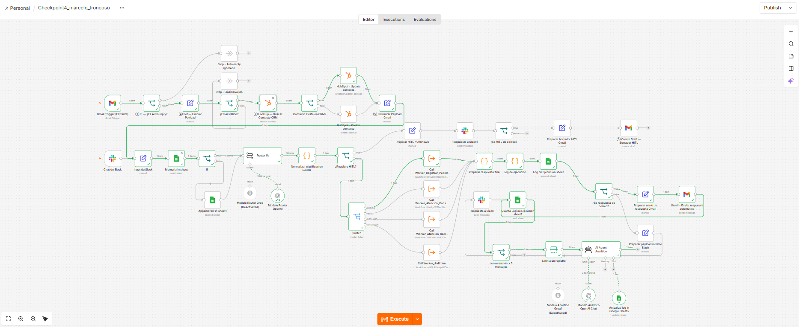
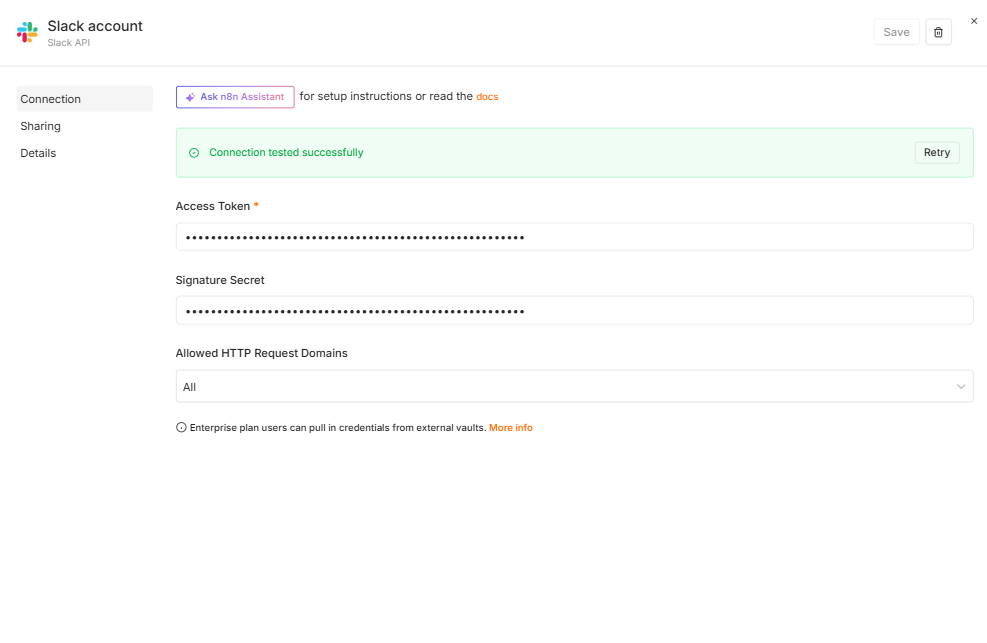
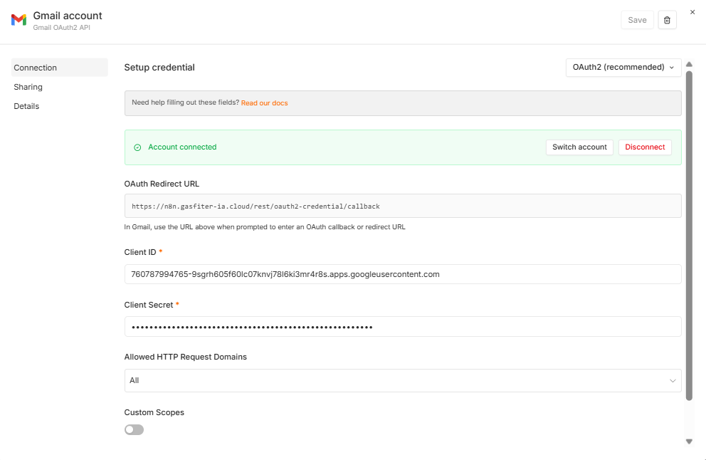
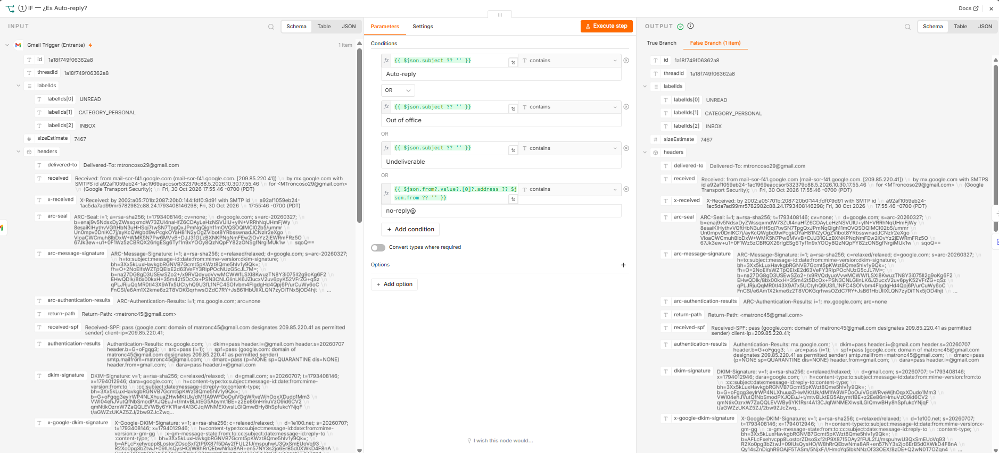
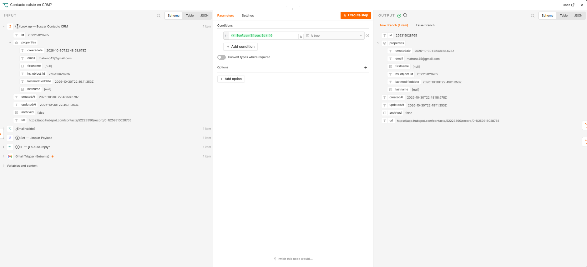
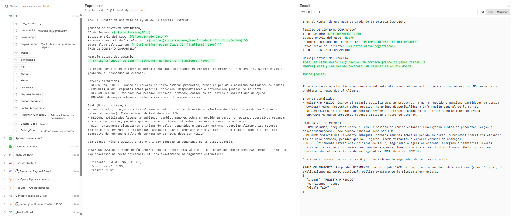
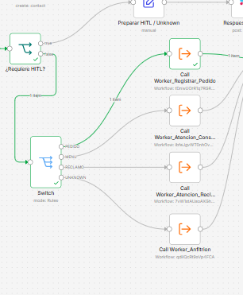
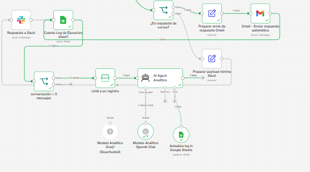

# GustoBot | Flujo omnicanal de pedidos y atención (Checkpoint 4)

---

## Descripción del proyecto

**GustoBot** es un asistente virtual para gestionar pedidos, consultas y reclamos de un restaurante. La versión vigente del workflow es el **Checkpoint 4**, que amplía la arquitectura multi-agente Manager-Worker con atención por Slack y Gmail, integración con HubSpot y distintos caminos de respuesta automática o revisión humana (HITL).

## Archivos y recursos

* **`Checkpoint4_marcelo_troncoso.json`**: workflow principal de n8n, con entradas desde Slack y Gmail, clasificación de solicitudes, derivación a workers, respuestas y registro.
* **`Worker_Registrar_Pedido.json`**: worker para registrar pedidos.
* **`Worker_Atencion_Consultas.json`**: worker para responder consultas.
* **`Worker_Atencion_Reclamos.json`**: worker para atender reclamos.
* **`Worker_Anfitrion.json`**: worker de bienvenida y solicitudes generales.
* **Planillas de datos y auditoría**: `Menu_GustoBot.xlsx`, `Pedidos_GustoBot.xlsx`, `Reclamos_GustoBot.xlsx` y `Logs_Ejecucion_GustoBot.xlsx`.
* **[Pantallazos de evidencia del Checkpoint 4](https://docs.google.com/document/d/1o2TdufEyv6BqBbX8gGqfmB_-vun86KBp8qrNTTiD2_0/edit?usp=drive_link)**: capturas de la entrega, disponibles en el documento compartido.
* [Planilla de logs en Google Sheets](https://docs.google.com/spreadsheets/d/1NmEYqoD3hRMmt2Ni0o4Um-sMYp7XUr-zP_bda_Aw64Y/edit?usp=drivesdk).
Flujo completo: 

## Arquitectura del Checkpoint 4

### 1. Ingreso por Slack y Gmail

* **Slack** recibe mensajes del canal configurado y los prepara en un payload mínimo para el procesamiento.

* **Gmail** consulta cada minuto los correos no leídos. Antes de procesarlos, el flujo descarta respuestas automáticas y mensajes de remitentes `no-reply`; luego normaliza remitente, asunto y cuerpo.

### 2. CRM y clasificacion

Para solicitudes recibidas por correo, el flujo busca el contacto en **HubSpot** y lo crea o actualiza según corresponda. El router IA clasifica las solicitudes en una taxonomía cerrada:

* `REGISTRAR_PEDIDO`
* `CONSULTA_MENU`
* `RECLAMO_SOPORTE`
* `UNKNOWN`

La clasificación se normaliza antes de continuar; una salida no reconocida se trata como `UNKNOWN`. El flujo incluye modelos de Groq y OpenAI para las etapas de IA.

### 3. Derivación a workers y revisión humana

El Manager deriva las solicitudes clasificadas a los sub-workflows correspondientes:

* `REGISTRAR_PEDIDO` -> `Worker_Registrar_Pedido`
* `CONSULTA_MENU` -> `Worker_Atencion_Consultas`
* `RECLAMO_SOPORTE` -> `Worker_Atencion_Reclamos`
* `UNKNOWN` y casos que requieren revisión -> camino de atención humana

Las llamadas a los workers esperan su finalización para preparar la respuesta. En Slack, los casos de revisión humana se comunican por el canal. Para Gmail, el flujo prepara un borrador para revisión; los casos que no requieren intervención pueden recibir una respuesta automática, previa validación del correo.

### 4. Memoria y auditoria

Google Sheets almacena los registros de ejecución y la memoria conversacional. El workflow recupera el historial y evalúa si supera los **5 mensajes** para activar el procesamiento analítico y actualizar el registro de memoria.

## Importar el workflow

Importa `Checkpoint4_marcelo_troncoso.json` en n8n y configura las credenciales necesarias para Slack, Gmail, HubSpot, Google Sheets y los modelos de IA. Revisa las conexiones, permisos y valores de configuración de cada integración antes de activar el workflow.

## Autor

* **Autor:** Marcelo Troncoso
* **Repositorio GitHub:** [matronc/n8n_avanzado](https://github.com/matronc/n8n_avanzado)
* **Entorno:** n8n Enterprise

